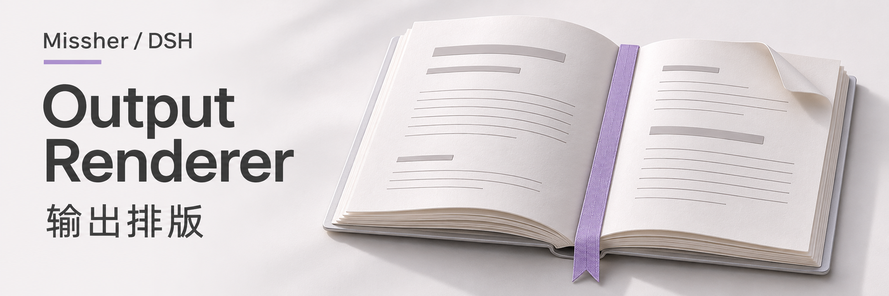
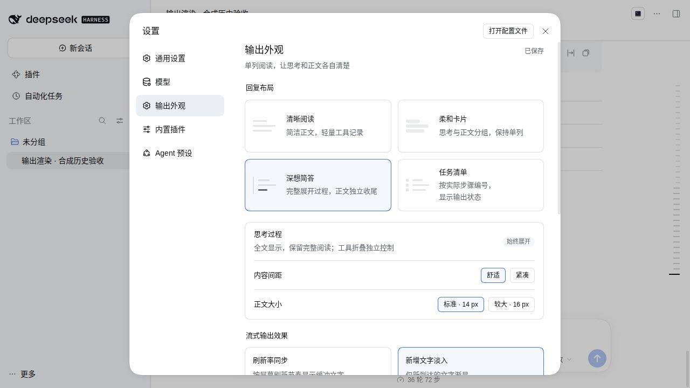
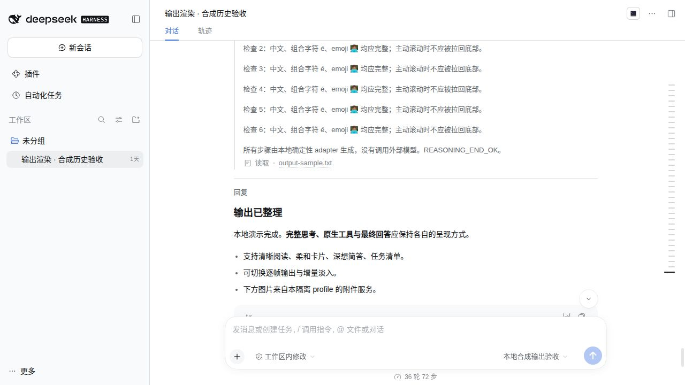

<h1>DSH Output Renderer · 输出外观</h1>

让回答、思考过程和搜索来源各有清楚的位置。

  
  

<a href="#功能一览">功能一览</a> · <a href="#快速开始">快速开始</a> · <a href="#visual-guide">图解使用</a> · <a href="#使用场景">使用场景</a> · <a href="#常见问题">常见问题</a> · <a href="#详细文档">详细文档</a> · <a href="../README.en.md">English</a>

---

<!-- current-source -->
当前开发源码：**1.0.2** · [分支 `main`](https://github.com/Missher12/Missher-DSH-Output-Renderer/tree/main)。安装包以实际 Release 为准。
<!-- /current-source -->

## 功能一览

| 能做什么 | 说明 |
| --- | --- |
| **四种阅读布局** | 清晰阅读、简洁对话、深想简答与任务清单。 |
| **思考与工具** | 按需展开过程，代码、图片和文件沿用宿主操作。 |
| **搜索来源** | 查看宿主已记录的网页来源，展开或收起来源卡片。 |
| **阅读偏好** | 调整字号、内容间距和流式文字效果，跟随深浅主题。 |

## 快速开始

1. 从 [Releases](https://github.com/Missher12/Missher-DSH-Output-Renderer/releases/tag/v1.0.2) 下载对应版本的 `.tgz` 安装包。
2. 在 DSH **插件 → 添加插件** 中选择下载的文件，安装并启用；按宿主提示重新加载或正常重启。
3. 打开 **设置 → 输出外观**，选择适合自己的阅读布局。

<!-- visual-guide -->

## 图解使用流程

按阅读任务选择布局，再分别调整正文、过程和流式显示。

[查看完整流程图](../docs/images/workflow-guide.svg)

| 步骤 | 怎样操作 | 需要留意 |
| --- | --- | --- |
| 1. 选阅读方式 | 在输出外观中比较清晰阅读、简洁对话、深想简答和任务清单。 | 布局改变显示方式，不把完整回复裁成固定长度。 |
| 2. 调整密度 | 选择正文大小与间距，打开一段长回复检查阅读感受。 | 标题、代码块、图片与文件仍使用宿主相应呈现能力。 |
| 3. 控制细节 | 根据需要展开思考或工具记录，两者分别控制。 | 只能展示模型和宿主已提供的内容，不能生成未返回的思考记录。 |
| 4. 看流式效果 | 在设置中预览刷新与新增文字效果。 | 已读内容应保持稳定，系统“减少动态效果”偏好继续有效。 |

### 试一次

> 阅读一份较长的方案：先选清晰阅读和合适字号，保留正文完整；需要核对执行依据时，再展开对应工具记录或来源。

使用后可以这样核对：

- 切换布局后正文内容仍完整。
- 代码、附件和工具操作仍可使用，折叠只影响显示。
- 有网络来源时展开已有来源卡片；未记录的来源不凭空补上。

### 设置怎么选

| 项目 | 建议 |
| --- | --- |
| 回复布局 | 按长文、短对话或步骤型任务选择；不必每个会话都用同一布局。 |
| 思考与工具 | 分别设置展开方式，避免把工具详情和回复正文混在一起。 |
| 字号与流式效果 | 先保证阅读和选择文本顺畅，再按个人偏好调整动态效果。 |

<!-- existing-screenshots -->
### 界面示例

<table><tr><td></td><td></td></tr></table>

已有 alpha.5 版本界面参考：左图为外观设置，右图为本地合成输出验收场景。不是本轮重新拍摄，也不代表真实模型回答质量。当前布局名称与设置以已安装版本为准。 详情见<a href="../README.md">项目原说明</a>，点击可放大。
<!-- /existing-screenshots -->

先比较设置入口与阅读布局，再观察右图中的正文和过程记录如何分开。历史图片用于理解结构，不能据图推断当前所有控件的位置。
<!-- /visual-guide -->

## 使用前了解

- 这是显示层插件，布局不会改变模型参数、回答内容或模型生成速度。
- 搜索来源展示依赖宿主提供相应能力；详细兼容范围与历史截图见下方文档。

<!-- readme-expansion -->
## 使用场景

| 遇到的情况 | 怎样使用 |
| --- | --- |
| 长回答的正文和工具过程混在一起，不方便阅读 | 选择清晰阅读或简洁对话，让正文与过程有更清楚的层级。 |
| 希望保留完整思考和执行过程 | 使用深想简答或任务清单，按实际步骤查看过程与状态。 |
| 想核对搜索回答引用了哪些网页 | 展开宿主已记录的来源胶囊和卡片，再打开原始来源。 |

## 常见问题

收起思考和工具，会删除原始对话吗？

这是阅读层面的折叠。代码、文件和宿主已有操作继续使用原生能力；会话数据仍由宿主保存。

动效越快，模型生成也会更快吗？

不会。显示刷新与模型生成速度相互独立；刷新率同步或新增文字淡入只决定已经到达的内容怎样呈现。

为什么有些搜索没有来源卡片？

来源来自宿主已有的结构化搜索记录，并依赖宿主展示能力。缺少对应能力或元数据时保留可用的原生展示，不额外抓取网页来补造来源。

## 搭配使用

配合 [推理强度](https://github.com/Missher12/Missher-DSH-Reasoning-Effort) 可以分别调整阅读方式和模型已声明的思考档位；这两项设置各自生效。

## 升级与数据

升级保留原会话与阅读偏好，先在预览区确认效果，再回到已有对话检查。历史截图会注明版本，当前布局以插件实际设置页为准。
<!-- /readme-expansion -->

## 详细文档

[项目原说明](../README.md) · [验证记录](../VALIDATION.md) · [来源与许可](../NOTICE.md) · [许可证](../LICENSE)

原有功能细节、配置、截图与验证记录保留在上述文档中，历史结论按其注明的版本理解。
