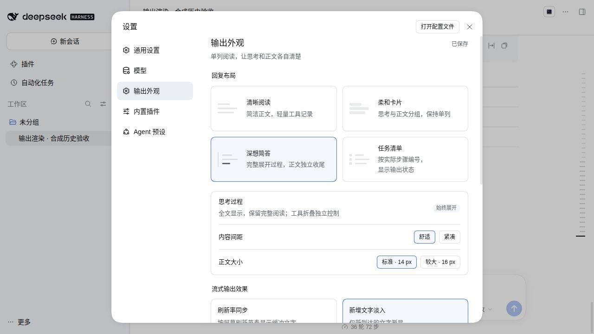

# Missher DSH Output Renderer

[简体中文](./README.md) · [Prebuilt downloads](https://github.com/Missher12/Missher-DSH-Output-Renderer/releases) · [Desktop app](https://github.com/Missher12/Missher-DeepseekHarness-Desktop) · [Issues](https://github.com/Missher12/Missher-DSH-Output-Renderer/issues)

Four assistant output layouts — the other three keep full reasoning while concise chat hides it — plus independent tool details and frame-synchronized or fading text for DeepSeek Harness. The package is `@missher/dsh-output-renderer`. **0.1.5 is the current published and installed version**; the intended **0.1.6** is not published or installed yet. This removable UI plugin requires an existing DSH host.

`0.1.3` is the historical published baseline (0.1.3 historical evidence): it widens the Cordis and Schemastery admission ranges to cover the stable `4.0.5` / `3.18.5` releases plus their `-alpha.1` prereleases, accepts host setting snapshots that no longer carry `mode`, reaches images through the host-published image Factory, binds the native-output takeover marker to the assistant seat's real registration lifetime, and fixes the responsive layout of a very narrow settings panel.

`0.1.5` is delivered and installed in the daily profile; `0.1.6` is the intended version, checked in the existing community `0.2.1-rc.2` real Web UI (see below) but **not published or installed yet**. Concise chat (stored value stays `cards`) now renders **no reasoning text at all**: the answer stays readable and one grey tool-activity line follows it; edits, reads, searches and successful foreground commands stay folded by default, expanding into light records with openable files. It appears above the input box while a Turn is running, moves under the answer when the Turn ends, and keeps its expanded state; failures, pending interactions and unknown tools keep their native rows. The other three layouts and the streaming RAF/fade are unchanged. Dated history is in [VALIDATION.md](./VALIDATION.md).



The two screenshots are real Web pages of official npm DSH `0.2.1-alpha.5` running plugin `0.1.3`. Their content is **synthetic test data produced in an isolated profile by a local deterministic adapter** — not a daily session, not real user content, and not output of an external model. They are historical `0.1.3` evidence only and do not represent `0.1.6`.


## Features

| Layout | Presentation |
| --- | --- |
| Clear reading | Continuous, single-column text with quiet tool details |
| Concise chat | No thinking body; one folded tool-activity line under the answer |
| Deep process, simple reply | The full process followed by a distinct final answer |
| Task checklist | Actual assistant step numbers with running, output-complete or stopped states |

Use **Settings → Output appearance** to choose the layout, 14/16 px text, comfortable/compact spacing and streaming effect. Changes save automatically. Equal-height cards become a single column in a narrow panel; **Replay output** previews the effect.

- Clear reading, deep process and task checklist keep the reasoning fully expanded, and process groups containing reasoning stay open. Concise chat renders no reasoning body (not even when expanded): only one grey tool-activity line under the answer. Edits, reads, searches and successful foreground commands stay folded (light records, openable files); failures, pending interactions and unknown tools keep their native rows, and no thinking summary or invented duration is produced.
- Code, tables, images and file actions use native host components. The process layout does not summarize or truncate answers. A checklist's output-complete state does not mean that a tool or task succeeded.
- Frame-synchronized output uses `requestAnimationFrame` without a fixed 30/60 fps cap. Fade-in affects only arriving text. Reduced-motion settings are respected, and stopping, finishing or hiding the page clears buffers and animations.
- The plugin does not change prompts, model parameters or generation speed. Actual frame rate depends on hardware, browser load and Markdown complexity; sustained full-refresh performance is not guaranteed.

## Install, enable, disable and uninstall

Use a prebuilt `.tgz` from [Releases](https://github.com/Missher12/Missher-DSH-Output-Renderer/releases); available release assets determine what is published. The delivered `0.1.5` filename is `missher-dsh-output-renderer-0.1.5.tgz`, with a matching `.tgz.sha256` file. The installation steps below use the downloaded tgz directly and do not depend on npm package-name resolution. **`0.1.6` is not published yet**, so the released asset decides the version.

1. Download the chosen tgz and checksum file. Verify with `shasum -a 256 -c missher-dsh-output-renderer-0.1.5.tgz.sha256`.
2. In the desktop app, open **Plugins → Add plugin**, enter the downloaded file's full path, then install and enable the plugin. Follow any reload prompt and open **Settings → Output appearance**.
3. Turn the plugin's enable switch off in plugin management to disable it, or on to enable it again. Disabling restores native output rendering.
4. Choose **Uninstall** on this plugin to remove it. To upgrade, use Update plugin in the current Missher desktop app and choose the new tgz. Back up the profile configuration and retain the old tgz first. Upgrade older desktop hosts that lack this update action; the host controls preference retention on uninstall.

For a Web or custom profile, use the target host's official CLI and replace the profile name and file path:

```sh
dsh plugin --profile my-web add /path/to/missher-dsh-output-renderer-0.1.5.tgz
dsh plugin --profile my-web remove @missher/dsh-output-renderer
```

The Electron-managed `desktop` profile must use desktop plugin management. A Release package needs no Node/pnpm development setup or source checkout. No separate compatibility bundle is required.

## Data and permissions

The plugin saves layout, motion, spacing and text-size preferences through the host ConfigForm under `output-renderer`. Defaults are clear reading, new-text fade-in, comfortable spacing and 14 px. Legacy `split`, `timeline` and `compact` settings are read as clear reading without rewriting stored values on read. When a host snapshot no longer carries the retired `mode` field, the host's own `writable` flag decides; when the field is present, only `host` may write and `memory` or an unknown value stays read-only.

It reads existing assistant content for display, creates no separate session database, and does not rewrite responses or attachments. It makes no model-service calls and adds no telemetry or API-credential configuration. Native host access controls and actions still handle images, files and links. Disabling or uninstalling removes plugin styles and subscriptions without deleting sessions, attachments or other plugins' settings; the host determines cleanup of this plugin's own preferences.

## Host and platform scope

The table keeps the historical acceptance evidence for the published `0.1.3` and is not proof for this candidate; the `0.1.6` state is in the acceptance section below, and the dated history is in [VALIDATION.md](./VALIDATION.md).

| Scope | Evidence and limits |
| --- | --- |
| Official npm alpha.5 (`0.2.1-alpha.5`, Cordis `4.0.5` / Schemastery `3.18.5`) | 0.1.3 historical evidence: passed the real Loader and settings, service scenarios covering normal saving, a missing settings service and a missing `configure`, controlled front-end SlotRegistry lifecycles, and real-page review of all four layouts, images, native zoom/tool expansion, save-failure rollback, stop-with-partial retention, 36-turn history loading, streaming fade and scroll-away stability; the 390 px settings panel and the 1280 px word wrapping were re-checked |
| Missher community-extended rc.2 (`0.2.0-rc.2`, Cordis `4.0.4` / Schemastery `3.18.4`) | 0.1.3 historical evidence: passed the same real Loader/settings scenarios, controlled slot lifecycles and real-page review (identical four-layout content, refresh persistence, native image zoom, narrow width and unload) |
| Missher community alpha.2 (`0.2.1-alpha.2`) | Static comparison only; no dynamic re-run this round, so the interaction between that bundle's chat fold animation and the forced-expanded reasoning styles remains unmeasured |
| 0.2.0-rc.1 | A historical baseline for earlier versions; not a new run for any current candidate |
| Windows / current macOS | Not tested this round. Acceptance ran on an independent Linux Host with a real Web browser; the native Electron daily UI was not operated |
| Other host versions | Untested. A widened `peerDependencies` range is an admission statement, not a full compatibility guarantee |

The renderer uses `conversation.chat.node` / `assistant-step`, `settings.section`, native Markdown and file callbacks, and version-related chat DOM markers. Images prefer the Chat-provided `renderMessageImages` closure and otherwise use the host-published `conversation.images.content` Factory; when neither exists the answer shows an explicit note instead of dropping the picture. Before calling any host face it checks `slots.inject/register`, `locale.register/bind` and `configForms.get`, reports what is missing and leaves native output visible. The host supplies React, Schemastery and DSH client modules; development SDK links are excluded from the runtime package. Recheck these interfaces after host upgrades. If the settings entry is absent, check whether the plugin is enabled and inspect host loading errors.

See [VALIDATION.md](./VALIDATION.md) for dated evidence. The historical 47 logic tests and the earlier controlled DOM/Web checks are separate evidence layers and are not added to this candidate's counts. Acceptance used an independent Linux Host and a real Web browser and did **not** operate the native Electron daily UI. Page content came from a **local deterministic adapter**, so the accurate wording is "no external model calls" rather than "zero model calls"; native desktop clicking, Windows/current macOS and sustained hardware frame rates are not claimed on this basis.

## Development and attribution

The authoritative repository is [Missher-DSH-Output-Renderer](https://github.com/Missher12/Missher-DSH-Output-Renderer), which includes prebuilt lib files. For development, run `node scripts/link-harness.mjs /path/to/built-harness` with an explicitly built 0.2.0-rc.2 checkout, then use pnpm 11 to install the locked development dependencies. Follow that SDK's Node requirements. The `harness-sdk` link, workspace overrides and test adapter are excluded from the tgz.

Run `pnpm typecheck` and run tests serially with `pnpm test --maxWorkers=1`. `pnpm build` writes lib in the current copy, so use an isolated development copy. `pnpm pack:bundle` packages the prepared lib files and refuses to overwrite an existing package with the same name. Do not rebuild a directory referenced by a daily installation.

Licensed under [MIT](./LICENSE). The client includes workspace-path helpers from DeepSeek Harness; attribution and the complete upstream license are in [NOTICE.md](./NOTICE.md) and [the original MIT text](./licenses/deepseek-harness-MIT.txt). Issue reports should include host/plugin versions, reproduction steps and redacted errors, not private sessions or credentials.

## Acceptance status (intended 0.1.6)

Checked in the existing community `0.2.1-rc.2` real Web UI; no wider platform verification was done:

- Window 98: client typecheck passed; 49 affected tests passed (34 concise-chat + 15 lifecycle).
- R10 changed only CSS alignment; window 101 build passed.
- Window 103: 1280 / 780 / 500 layouts, file opening, live Turn → turn-tail handover with the fold preserved and no duplicate, and fully hidden reasoning all passed.
- Window 107: successful commands summarized, exit-code-7 failure kept its native detail, reader/cards save-switch-restore passed.
- Window 108: disabling the installed Bundle zeroed the controllers/summary, removed the root marker and restored native read history without a restart.
- Windows 107 / 108 exited naturally (Host/runner exit 0) with finalized and guard checks complete; they made 4 and 0 local synthetic-adapter calls respectively, with **0 external acceptance calls**.

Scope is limited to that community rc.2 Web UI: it does not represent the official host, native desktop, cross-platform behaviour or real-provider performance. The `0.1.3` official alpha.5 evidence remains historical only. Past failures and fixture issues stay historical, not open product problems. Zero external acceptance calls does **not** mean zero development calls; this native round was not zero-call.
