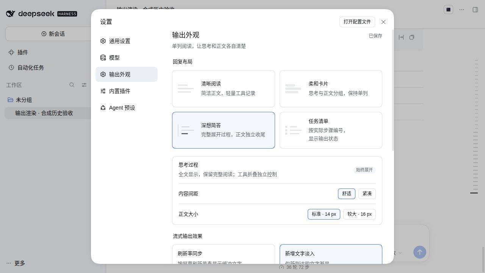

# Missher DSH Output Renderer · 输出外观

[English](./README.en.md) · [下载预构建包](https://github.com/Missher12/Missher-DSH-Output-Renderer/releases) · [桌面端](https://github.com/Missher12/Missher-DeepseekHarness-Desktop) · [问题反馈](https://github.com/Missher12/Missher-DSH-Output-Renderer/issues)

为 DeepSeek Harness 提供四种助手输出布局——其中其余三种布局保留完整思考，简洁对话隐藏思考——以及刷新率同步或新增文字淡入效果。包名为 `@missher/dsh-output-renderer`。**0.1.5 是当前已发布并安装的版本**；意向版本 **0.1.6** 尚未发布或安装。这是可卸载的界面插件，需要已有 DSH 宿主。

`0.1.3` 是历史已发布基线（0.1.3 历史证据）：放宽 Cordis 与 Schemastery 的准入范围以覆盖 `4.0.5` / `3.18.5` 正式版及其 `-alpha.1` 预发布，兼容宿主快照不再携带 `mode` 的设置契约，图片改走宿主发布的图片 Factory，把原生输出的接管标记绑定到助手槽位的真实注册生命周期，并修复极窄设置面板的响应式排版。

`0.1.5` 已交付并在日常 profile 中安装；`0.1.6` 是本次意向版本，在现有 community `0.2.1-rc.2` 真实 Web UI 上完成窗口级验收（见下），但**尚未发布或安装**。简洁对话（持久化值仍是 `cards`）现在完全**不显示 reasoning 正文**：正文保持阅读，下方是一行淡灰工具活动摘要；编辑/读取/搜索/成功的前台命令默认折叠，展开后是轻量记录，文件可打开。运行时显示在输入框上方，结束后移到答复末尾并保留展开状态；失败、待交互和未知工具保留原生行。其余三种布局、流式 RAF/fade 均未改变。历史版本记录见 [VALIDATION.md](./VALIDATION.md)。



上图与下图为官方 npm DSH `0.2.1-alpha.5` 上插件 `0.1.3` 的真实 Web 页面截图，内容为**隔离 profile 中的合成测试数据**，使用本地确定性适配器产生，不是日常会话、不是真实用户内容，也不是外部模型生成。它们只作为 `0.1.3` 的历史证据，不代表 `0.1.6`。


## 功能

| 布局 | 呈现方式 |
| --- | --- |
| 清晰阅读 | 连续单列正文，弱化工具区域的视觉干扰 |
| 简洁对话 | 不显示思考正文；正文下方一行工具活动摘要，默认折叠 |
| 深想简答 | 完整展示过程，末尾答复独立收尾 |
| 任务清单 | 按实际助手步骤编号，显示输出中、输出完成或已停止 |

在 **设置 → 输出外观** 选择布局、14/16 px 字号、舒适/紧凑间距和动效，修改自动保存。四张选项卡片等高排列，窄窗口自动转为单列；可用“重播输出”查看动效。

- 清晰阅读、深想简答和任务清单保持思考全文展开，含思考的过程组不再折叠。简洁对话不渲染 reasoning 正文（展开后也没有），正文下方只有一行淡灰工具活动摘要：编辑/读取/搜索/成功的前台命令默认折叠，展开是轻量记录、文件可打开；失败、待交互、未知工具保留原生行，不生成思考摘要或虚构时长。
- 代码、表格、图片和文件操作复用宿主组件。深想简答不自动摘要或截断正文；任务清单的“输出完成”不表示工具或任务执行成功。
- 刷新率同步使用 `requestAnimationFrame`，没有固定 30/60 fps 上限；新增文字淡入只作用于新到达的文字。遵循系统“减少动态效果”，停止、结束和后台切换会清理缓冲及动画。
- 布局不改变提示词、模型参数或生成速度。实际帧率受硬件、浏览器和 Markdown 复杂度影响，不承诺持续满帧。

## 安装、启停与卸载

推荐使用 [Releases](https://github.com/Missher12/Missher-DSH-Output-Renderer/releases) 中的预构建 `.tgz`，版本以实际发布资产为准。已交付的 `0.1.5` 文件名为 `missher-dsh-output-renderer-0.1.5.tgz`，校验文件为同名 `.tgz.sha256`。下列安装流程使用下载的 tgz 文件，不依赖 npm 包名解析。**`0.1.6` 尚未发布**，资产以实际发布为准。

1. 下载所需版本的 tgz 和校验文件。可运行 `shasum -a 256 -c missher-dsh-output-renderer-0.1.5.tgz.sha256` 核对下载字节。
2. 桌面版进入 **插件 → 添加插件**，填入下载文件的完整路径，安装并启用本插件。按宿主提示重新加载后，进入 **设置 → 输出外观**。
3. 在插件管理中关闭本插件的启用开关即可停用；重新打开可启用。停用后恢复宿主原生输出。
4. 在插件管理中选择本插件并点击 **卸载** 可移除。升级请优先使用当前 Missher 桌面端的“更新插件”入口，选择新版 tgz；先备份 profile 配置并保留原版本 tgz。较早宿主若没有更新入口，请先升级桌面端；卸载后的偏好保留行为由宿主管理。

Web/自建 profile 使用目标宿主的正式 CLI，替换下面的 profile 和文件路径：

```sh
dsh plugin --profile my-web add /path/to/missher-dsh-output-renderer-0.1.5.tgz
dsh plugin --profile my-web remove @missher/dsh-output-renderer
```

桌面 `desktop` profile 由 Electron 管理，请使用桌面插件界面。安装 Release 包不需要 Node/pnpm 开发环境或本地源码；不需要额外兼容包。

## 数据与权限

插件通过宿主 ConfigForm 在 `output-renderer` 命名空间保存布局、动效、间距和字号；默认清晰阅读、新增文字淡入、舒适间距和 14 px。旧 `split`、`timeline`、`compact` 值只读映射为清晰阅读，不在读取时覆写原值。宿主快照不再携带旧 `mode` 字段时以宿主自己的 `writable` 为准；仍然携带时只有 `host` 可写，`memory` 或未知值保持只读。

插件读取已有助手内容用于显示，不创建独立会话库、不改写回复或附件，不调用模型服务，不新增遥测或 API 凭据配置。图片、文件和链接仍使用宿主的访问控制与原生操作。停用或卸载会清理本插件样式和订阅，不删除会话、附件或其他插件设置；插件偏好本身的清理由宿主决定。

## 宿主与平台范围

下表保留已发布 `0.1.3` 的历史验收证据，不能当作本候选证明；`0.1.6` 的当前状态见下方「验收状态」，按时间排列的历史记录见 [VALIDATION.md](./VALIDATION.md)。

| 检查范围 | 证据与限制 |
| --- | --- |
| 官方 npm alpha.5（`0.2.1-alpha.5`，Cordis `4.0.5` / Schemastery `3.18.5`） | 0.1.3 历史证据：已通过真实 Loader 与设置；服务场景含正常保存、缺少 settings、缺少 configure；真实前端 SlotRegistry 受控生命周期；真实 Web 页面复核四布局、图片、原生放大/工具展开、保存失败回退、停止保留、36 轮历史加载、流式淡入与滚离底部；390 px 设置面板与 1280 px 词语分行均复验 |
| Missher 社区扩展 rc.2（`0.2.0-rc.2`，Cordis `4.0.4` / Schemastery `3.18.4`） | 0.1.3 历史证据：已通过同一组真实 Loader/设置场景、受控插槽生命周期与真实 Web 页面复核（四布局内容一致、刷新持久化、原生图片放大、窄屏与卸载） |
| Missher 社区 alpha.2（`0.2.1-alpha.2`） | 仅完成只读静态对照；本轮未做动态复验，该配套包的聊天折叠动画与本插件强制展开思考的样式交互仍未实测 |
| 0.2.0-rc.1 | 较早版本的历史验收基线，不代表任何当前候选重新实测 |
| Windows / 当前 macOS | 本轮未测。验收在 Linux 上的独立 Host 与真实 Web 浏览器中进行，未操作原生 Electron 日常界面 |
| 其他宿主版本 | 未实测。`peerDependencies` 的放宽只是准入声明，不是全量兼容保证 |

插件依赖 `conversation.chat.node` 的 `assistant-step`、`settings.section`、原生 Markdown 与文件回调，以及聊天 DOM 标记；图片优先使用 Chat 提供的 `renderMessageImages` 闭包，其次使用宿主发布的 `conversation.images.content` Factory，两者都不存在时在正文位置显示明确提示而不是丢图。调用宿主能力前会检查 `slots.inject/register`、`locale.register/bind` 与 `configForms.get` 是否存在，缺失时给出诊断并保持原生输出可见。React、Schemastery 及 DSH 客户端模块由宿主提供；开发 SDK 链接不会进入运行包。升级宿主后需重新核验这些接口，若设置页不出现，检查插件启用状态和宿主加载错误。

完整证据见 [VALIDATION.md](./VALIDATION.md)。历史 47 项逻辑测试、较早的受控 DOM/Web 检查与本次候选的验收属于不同层级，不合并计数。本次验收使用 Linux 独立 Host 与真实 Web 浏览器，**未**操作原生 Electron 日常界面；界面内容由**本地确定性适配器**产生（非外部模型或服务端生成图片），因此准确表述是"无外部模型调用"，不是"零模型调用"；原生桌面点击、Windows/当前 macOS 与持续硬件满帧率均未据此宣称通过。

## 开发与署名

当前独立源码仓库为 [Missher-DSH-Output-Renderer](https://github.com/Missher12/Missher-DSH-Output-Renderer)。克隆已带预构建 lib；开发 SDK 通过 `node scripts/link-harness.mjs /path/to/built-harness` 显式连接已构建的 0.2.0-rc.2 源码，随后用 pnpm 11 安装锁定开发依赖。构建环境要求以该 SDK 的 Node 要求为准。开发链接 `harness-sdk`、工作区 override 和测试适配器均不进入 tgz。

执行 `pnpm typecheck`，并以 `pnpm test --maxWorkers=1` 串行运行测试。`pnpm build` 会写当前副本的 lib，因此维护时须在隔离副本构建；`pnpm pack:bundle` 只打包已准备好的 lib，并拒绝覆盖已有同名包。不要重建日常安装链接指向的目录。

本插件使用 [MIT License](./LICENSE)，包含 DeepSeek Harness 的 workspace-path 辅助代码；原版权声明与完整许可见 [NOTICE.md](./NOTICE.md) 和 [上游 MIT 原文](./licenses/deepseek-harness-MIT.txt)。反馈请附宿主/插件版本、复现步骤和脱敏错误，不提交真实会话或凭据。

## 验收状态（0.1.6 意向版本）

在现有 community `0.2.1-rc.2` 真实 Web UI 中完成以下窗口检查，平台侧未做其他扩展验证：

- 窗口 98：client typecheck 通过；49 项受影响测试通过（34 项简洁对话 + 15 项生命周期）。
- R10 仅 CSS 对齐改动；窗口 101 构建通过。
- 窗口 103：1280 / 780 / 500 宽度排版、文件打开、进行中的摘要显示在输入框上方、回合结束后移到答复末尾并保留展开且不重复、reasoning 完全不出现，均通过。
- 窗口 107：成功命令进入摘要、退出码 7 的失败保留原生详情、reader/cards 保存切换与恢复通过。
- 窗口 108：停用已安装 Bundle 后 controllers/summary 清零、root marker 移除、原生 read 历史恢复，无需重启。
- 窗口 107 / 108 均自然退出（Host/runner exit 0），finalized 与 guard 齐全；分别有 4 和 0 次本地合成适配器调用，**外部模型验收为 0**。

范围仅限上述 community rc.2 Web UI：不代表官方宿主、native desktop、跨平台或真实 provider 性能验证；`0.1.3` 的官方 alpha.5 证据仍只作历史。过去失败与夹具问题保留为历史记录，不是当前未解决的产品问题。外部验收为 0 也**不等于**开发调用为 0，本轮原生开发并非零调用。
